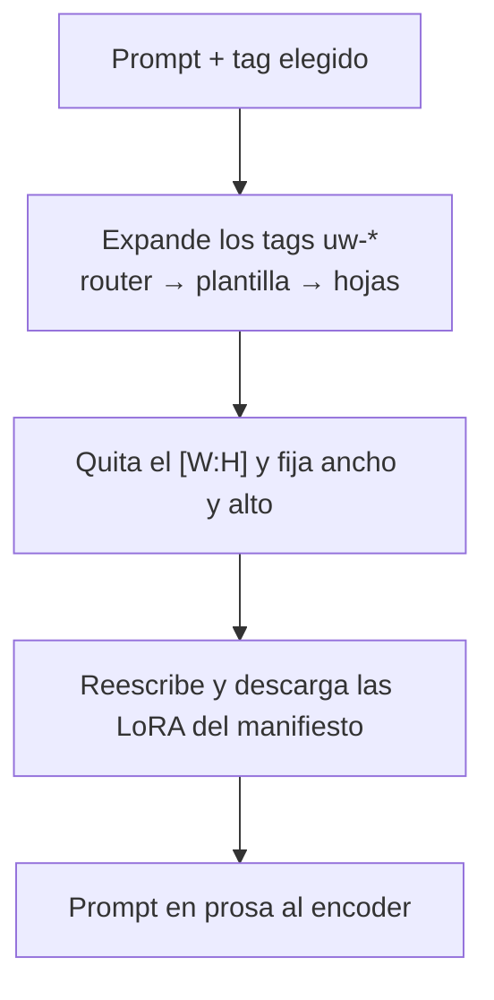

# UW Wildcards

Acordeón para Forge Neo que genera con el pack
[UW Modular NSFW Wildcards](https://civitai.red/models/2789815) en txt2img e
img2img: eliges un router o una plantilla y el prompt que llega al modelo es
prosa normal, con el tamaño y las LoRA ya resueltos.

## Para qué sirve

El pack no es una lista de palabras. Son plantillas con 17 huecos —edad, pelo,
ropa, luz, encuadre…— que se combinan solas. Cada hueco es una hoja del YAML con
su propio pool de opciones. Encima hay routers, que eligen una plantilla del
tema, y correcciones por hueco: fijar uno, omitirlo o volver a sortearlo. Todo
eso está pensado para un nodo de ComfyUI.

En Forge, sin esta extensión, tres cosas no funcionan:

- `__uw-krea2-nsfw/router/…__` no es texto que el modelo entienda.
- el `[9:16]` que traen muchas plantillas se queda dentro del prompt.
- un `<lora:krea2/…>` tiene que apuntar a un fichero que ya exista en disco.

La extensión traduce el tag a prosa, saca el marcador a ancho y alto, y descarga
la LoRA si el prompt trae un tag del manifiesto.

No sustituye a Dynamic Prompts: se ejecuta antes y deja el resto de `__tags__`
(por ejemplo `__film/…`) para que esa extensión los expanda. Tampoco trae el
pack ni los pesos.

## Cómo funciona



Con el acordeón apagado no se toca nada: ni prompt, ni tamaño, ni descarga.

### Un JSON, no 17 campos

Cada corrección se guarda en un objeto que viaja en un campo oculto:

```json
{"tag":"__uw-krea2-nsfw/router/portrait-swimsuit-pics__","overrides":{"lighting":"harsh noon sun"},"counters":{}}
```

- `tag`: el router o la plantilla del desplegable. Si no está en el prompt, se
  añade al final.
- `overrides`: el texto fijo de cada hueco. Un hueco omitido guarda un carácter
  centinela en lugar de texto.
- `counters`: cuántas veces has regenerado cada hueco.

Los botones solo reescriben ese objeto. No generan, no piden red y no tocan el
resto de campos.

### Semilla por hueco

Cada hueco tira de `sha256(semilla_de_la_imagen, hueco, contador)`. Por eso
regenerar la luz no mueve el pelo ni la edad, y por eso la misma semilla repite
el mismo texto mientras no cambies un contador.

El precio: con varias líneas en un mismo pool, el texto no coincide con el que
saca el nodo de Comfy para esa semilla. La extensión prioriza que los huecos
sean independientes entre sí.

### Puntuación

Una plantilla encadena huecos con comas y termina en punto. Si omites uno, el
texto se limpia: no quedan `,,` ni `BODY.,` ni comas colgando antes del punto.

## Cómo se usa

### Antes de empezar

1. Instala el pack en la carpeta `wildcards/` del directorio de datos de Forge
   (con `--data-dir /data`, es `/data/wildcards`). Vale cualquier subcarpeta:
   el catálogo es recursivo. Si esa carpeta no existe, se usa la de
   `sd-dynamic-prompts`. Con el pack completo, el desplegable lista 79 routers y
   358 plantillas.
2. Si vas a usar tags `<lora:…>` del manifiesto, ten a mano la clave de Civitai
   (ver [Ajustes](#ajustes)). Sin tags de LoRA no hace falta.

### 1. Activa el acordeón

En txt2img o img2img, abre **UW Wildcards** y déjalo encendido.

### 2. Elige un router o una plantilla

En **Router o plantilla** aparecen los tags `__uw-…/router/…__` y
`__uw-…/template/…__`. Un router sortea una plantilla del tema y la expande; una
plantilla concreta va directa a esa.

El elegido se añade al final de tu prompt si no está ya escrito. Lo que haya
antes se queda delante tal cual: si escribes `a woman at the pool`, acuérdate de
la coma, porque el tag se pega detrás sin separador. Con el prompt vacío, el
prompt es solo el tag.

También puedes escribir tags `uw-*` a mano en el prompt, varios si quieres:
todos se expanden con el mismo estado.

Si acabas de copiar YAML nuevo a `wildcards/`, pulsa **Recargar lista** en vez
de reiniciar Forge.

### 3. Genera

Dale a Generate como siempre. En el prompt de la imagen ya no queda ni el tag ni
el `[W:H]`: queda la prosa. Con el router `portrait-swimsuit-pics` y semilla 1,
el prompt empieza así:

```
A candid selfie photograph of a woman around twenty-five, chinese with ivory
skin and chocolate brown eyes. … unposed candid capture.
```

### 4. Corrige un hueco

Los 17 campos no muestran lo que ha salido; son el valor que tú quieres imponer.
Para reutilizar algo que te gustó, cópialo del prompt generado.

- **Fijar**: escribe el texto en el campo del hueco y pulsa **Fijar**. Ese texto
  sustituye al hueco en todas las plantillas del prompt, aunque cambies de
  semilla. Con el campo vacío, Fijar quita la corrección.
- **Omitir**: quita ese hueco de la frase y limpia la puntuación. Se deshace con
  **Regenerar** o fijando un texto.
- **Regenerar**: borra la corrección de ese hueco, sube su contador y vacía el
  campo. La próxima generación sortea otra opción solo ahí.

Por ejemplo, con `lighting` fijado a `harsh noon sun`, la frase pasa de
`high sun with gentle open shade from a cabana canopy` a `harsh noon sun`,
mientras el pelo, la edad y la ropa siguen dependiendo de la semilla.

Un hueco fijado se mantiene al cambiar de router. Si la plantilla nueva no tiene
ese hueco, el valor no se usa.

### 5. Ajusta el tamaño

Con **Aplicar marcador de aspecto** activo, el ancho y alto del tab se
sustituyen al generar:

- Si el prompt o la plantilla acaban en `[W:H]`, esa relación manda. El marcador
  sale del prompt.
- Si no hay marcador, en txt2img se usa **Relación si no hay marcador** (`3:4` por defecto). En img2img, sin marcador, se deja el tamaño de la imagen inicial.
- **Megapíxeles** es el presupuesto total (`1.0` por defecto) y **Múltiplo de
  ancho y alto** redondea el resultado (`16` por defecto).

Un `[W:H]` que ya hubiera al final del prompt se aparta y se vuelve a aplicar
después de expandir, para que no quede en medio de la frase. Si la plantilla
trae el suyo, gana el de la plantilla. Todo el batch comparte un tamaño: ancho y
alto se fijan una vez para el job, con el marcador del primer prompt.

Con 1 MP y una plantilla `[9:16]` el resultado es `752×1328`.

### 6. LoRA (opcional)

Las plantillas del pack no traen `<lora:…>`: el propio YAML pide cargar la LoRA a
mano en el workflow de ComfyUI. La descarga existe para cuando tú escribes un
tag del manifiesto en el prompt, por ejemplo:

```
<lora:krea2/nsfw/snofs_krea_v1_3D:0.6>
```

Al generar, si el fichero no está, se descarga a
`{carpeta_de_LoRA}/UWModularWildcards/krea2/nsfw/snofs_krea_v1_3D.safetensors` y
el tag pasa a apuntar ahí, para que Forge lo encuentre. La segunda generación
no vuelve a pedirlo.

Con **Descargar LoRA que falten** desmarcado, el tag se reescribe si el fichero
ya existe y no se descarga nada.

Si falta el fichero y la descarga no puede hacerse, la generación se detiene y
el mensaje nombra el alias: sin clave, con clave caducada, con un redirect a
login, o con Civitai en SFW only. Un tag que no esté en el manifiesto se deja
como está y no dispara ninguna búsqueda por nombre.

## Los 17 huecos

| Campo | Clave en el JSON |
|-------|------------------|
| Ropa | `wardrobe` |
| Entorno | `environment` |
| Medio | `medium` |
| Luz | `lighting` |
| Tratamiento | `treatment` |
| Pelo | `hair` |
| Cuerpo | `body` |
| Edad | `age` |
| Color de ojos | `eye_color` |
| Nacionalidad | `nationality` |
| Piel | `skin` |
| Rostro | `face` |
| Joyas | `jewelry` |
| Tono de piel | `skin_tone` |
| Color de pelo | `hair_color` |
| Pecho | `breast_size` |
| Cadera | `butt_size` |

## Qué se guarda en la imagen

El PNG/JPEG guarda el prompt ya expandido y, en los parámetros, el JSON bajo
`UW Wildcards` y el prompt previo a la expansión bajo `UW Template`. Al pegar
ese infotext o usar **Send to txt2img**, el cuadro de prompt vuelve a la
plantilla (si se dejara la prosa, el router se añadiría otra vez y saldría una
segunda escena) y se restauran el router, las correcciones y los contadores.
El campo oculto se llama **UW cláusulas** para no chocar con el nombre del
acordeón.

## Ajustes

**Settings → UW Wildcards → CivitAI API key**. Solo se usa si CivitAI Browser
Neo no tiene ya su `Personal CivitAI API key`: la del browser tiene prioridad.

El dominio se toma de `civitai_sfw_only` (`civitai.com` o `civitai.red`) y el
proxy de `custom_civitai_proxy`, igual que el browser.

## Instalar la extensión

En Forge: Extensions → Install from URL, con la URL de este repositorio. Apply
and restart UI.

No forma parte de la semilla de docker-neo (`.no-seed`).

## Probar

```sh
python3 -m unittest tests.test_api_key tests.test_aspect tests.test_lora_fetch tests.test_clauses tests.test_catalog tests.test_script_hooks -v
```

El corpus YAML del pack no se versiona: los tests usan un fixture mínimo en
`tests/fixtures/` y no tocan la red ni importan `modules`.

## Límites conocidos

- El pack, las miniaturas y los pesos los trae quien usa la extensión. La
  extensión no los descarga.
- Los campos de los 17 huecos no se rellenan con lo sorteado: para fijar un
  texto hay que copiarlo del prompt generado.
- En txt2img, con el aspecto activo y sin `[W:H]`, el tamaño pasa a ser la
  relación por defecto. En img2img, sin marcador, se respeta el tamaño de la
  imagen inicial.
- Con la misma semilla, el texto no reproduce el de Comfy cuando un pool tiene
  varias líneas.
- SNOFS v1.3D se publica como LoKR. La extensión garantiza que el fichero llega
  a su ruta; que el loader de Forge lo cargue hay que verlo en el WebUI.
- Mrpopo publica dos LoRA en una sola versión y el manifiesto solo guarda el id
  de versión: se descarga el fichero primario, no el segundo.
