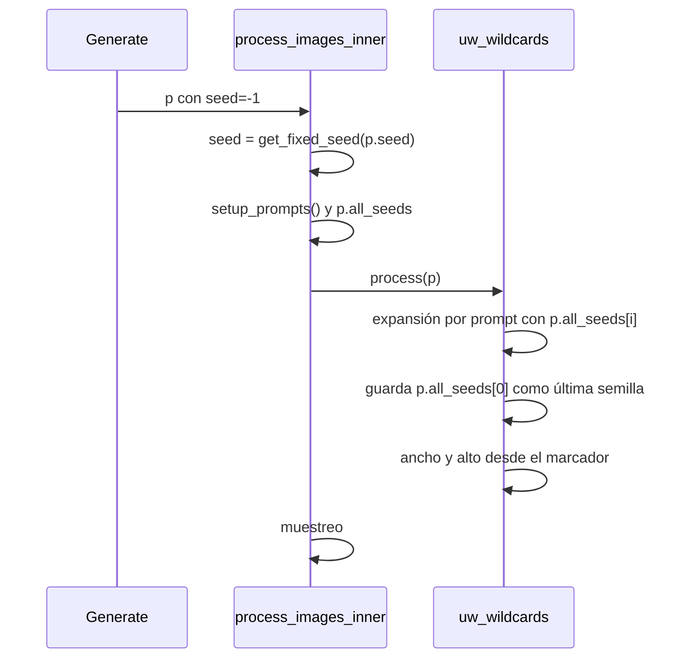
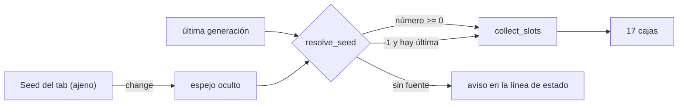

# Spec: inspector de huecos UW

Fecha: 2026-10-24

Continúa [spec.md](spec.md), cuyas slices A y B ya están en `main`. No cambia el
formato del pack ni el manifiesto.

## Objective

Quien genera con el acordeón no puede ver qué texto sorteó cada uno de los 17
huecos. Los campos solo sirven para imponer un texto propio: para conservar el
pelo que salió hay que leerlo en el prompt generado y copiarlo a mano. El
resultado es que la gente no fija nada y cada semilla rebaraja la escena entera.

El objetivo es que un clic enseñe lo que sorteó una semilla concreta y que fijar
cualquiera de esos textos cueste otro clic.

Éxito: elegir router, generar, pulsar **Ver lo generado**, fijar el pelo que gustó y
regenerar sin copiar texto.

### Fallo previo que hay que corregir

Con semilla aleatoria el sorteo no cambia entre generaciones. Dos peticiones a
`/sdapi/v1/txt2img` con `seed: -1` en el Forge de esta máquina:

| Petición | Semilla que usó | Cláusula «medio» |
|----------|-----------------|------------------|
| 1 | 3196705980 | A casual amateur snapshot of a woman around twenty-five, irish with honey skin and light brown eyes… |
| 2 | 617996018 | idéntica, palabra por palabra |

La causa es el hook. `before_process` corre en `process_images` **antes** de que
`process_images_inner` resuelva `get_fixed_seed(p.seed)`, llame a
`p.setup_prompts()` y rellene `p.all_seeds`. La extensión lee `p.seed`, que vale
`-1`, y `hash(-1, hueco, contador)` devuelve siempre lo mismo. Con semilla fija
el fallo no se ve, y por eso pasó el slice B.

Entra en este slice porque el inspector no puede prometer «esto es lo que salió»
mientras el sorteo no dependa de la semilla real.

## Comportamiento

1. Dentro del acordeón, un botón **Ver lo generado** y una línea de estado.
2. La semilla de la vista se resuelve así:
   - si el campo Seed del tab tiene un número mayor o igual que 0, esa;
   - si vale `-1`, la de la última generación en ese tab;
   - si no hay ninguna, la línea de estado lo dice y no se rellena nada.
3. Rellena los 17 campos con el texto que salió para esa semilla. La línea de
   estado nombra la semilla y de dónde sale, porque las dos fuentes no son lo
   mismo: `Semilla 3196705980 · última generación · imagen 1 de 3`, o
   `Semilla 1234 · campo Seed`. La segunda es una predicción exacta, no algo que
   ya salió, y el texto lo dice para no prometer de más.
4. No toca el JSON: fijar sigue siendo explícito. Cada **Fijar** conserva el
   texto que haya en su caja, que es el que acaba de aparecer.
5. Botón **Vaciar** que deja los 17 campos en blanco.
6. Con el acordeón apagado no se calcula nada.

## Tech Stack

Sin dependencias nuevas, sin `install.py`. Gradio y `modules.scripts` los que ya
usa la extensión. Tests con `unittest`, sin red y sin importar `modules`.

## Design

### 1. La expansión pasa a `process`

`process_images_inner` hace, en este orden: `p.setup_prompts()`, `p.all_seeds`,
`p.scripts.process(p)`, `p.init(...)` y el muestreo. En `process` la semilla ya
está resuelta y cada prompt del lote tiene la suya, así que la expansión se mueve
ahí y `before_process` deja de reescribir prompts.



Consecuencias, todas deseadas:

- Con `-1`, cada generación sortea de verdad.
- Un lote de N deja de compartir texto: cada imagen usa su semilla. El tamaño
  sigue siendo uno solo para el job, como ya decidía el slice A.
- `p.main_prompt` se actualiza junto a `p.all_prompts[0]`, porque
  `setup_prompts` lo fijó antes y quedaría con el texto sin expandir.
- Dynamic Prompts sigue viendo los `__tags__` que no son `uw-*`: `metadata.ini`
  ya la coloca detrás.

Alternativa descartada: seguir en `before_process` y resolver la semilla a mano
con `get_fixed_seed`. Funcionaría, pero el valor que se sortea no es el que usa
el muestreador, y la vista previa mentiría en cuanto se generara.

### 2. Collect de los huecos

`expand_with_overrides` gana un parámetro opcional `trace: dict | None`. Cuando
llega, `_pick` anota `trace[_slot_id(clave)] = texto_elegido`, salvo que el texto
sea vacío. No hay un segundo renderizador: el texto que se enseña sale del mismo
código que el que se genera, que es la única forma de que la vista previa no
derive.

```python
def collect_slots(catalog: dict, state: dict, seed: int) -> dict[str, str]:
    """Texto que sortea cada hueco para esa semilla, con los overrides aplicados."""
```

Reglas del collect:

- Un hueco fijado devuelve el texto fijado.
- Un hueco omitido no aparece en el diccionario; la caja se queda vacía.
- El centinela de skip no se enseña nunca.
- Solo se devuelven las 17 claves de `SLOT_LABELS`.

Alternativa descartada: expandir cada hueco por separado con su clave de catálogo.
Obliga a reproducir a mano el mapeo de `_is_override_key` y se rompe en cuanto el
pack añade una hoja.

### 3. Semilla del tab

`Script.show()` registra `on_after_component` para `txt2img_seed` e
`img2img_seed`. Tiene que ser en `show()`: `apply_on_before_component_callbacks()`
vacía las listas de cada script al terminar de cargarlos, antes de que corra
cualquier `ui()`, así que registrarlo allí no dispara nunca.

El callback conecta el `.change()` del campo de semilla con un `gr.Textbox`
oculto propio. Es un adaptador: el botón lee siempre ese espejo y no depende de
que el componente ajeno exista, así que si Forge cambia el `elem_id` el botón
sigue funcionando con la última generación.



`resolve_seed(espejo: str, ultima: int | None) -> int | None` es una función pura
en `inspector.py`. Con dos fuentes basta una cadena de prioridad; una jerarquía
de estrategias sobraría.

### 4. Interfaz

La fila va arriba del acordeón, antes de los 17 campos:

```
[Ver lo generado] [Vaciar]     Semilla 3196705980 · imagen 1 de 3
```

Las cajas siguen siendo editables: sirven para escribir un texto a mano y
pulsar Fijar, como hoy. Que una caja tenga texto no significa que esté fijada; la
línea de estado no lo afirma y el JSON es la única verdad.

Un hueco omitido se enseña con la caja vacía. Fijar sobre una caja vacía quita la
corrección, igual que hoy, así que deshacer un **Omitir** se hace con
**Regenerar**, no con **Fijar**.

## Commands

```sh
# tests, desde la raíz del repo de la extensión
python3 -m unittest tests.test_api_key tests.test_aspect tests.test_lora_fetch tests.test_clauses tests.test_catalog tests.test_inspector -v
```

No hay lint ni build. La comprobación de la semilla resuelta necesita el WebUI:

```sh
curl -s http://127.0.0.1:7860/sdapi/v1/txt2img -H 'Content-Type: application/json' \
  -d '{"prompt":"__uw-krea2-nsfw/router/portrait-swimsuit-pics__","seed":-1,"steps":1,
       "width":256,"height":256,
       "alwayson_scripts":{"uw wildcards":{"args":[true,true,0.25,"3:4",16,false,"{}"]}}}'
```

## Project Structure

```text
forge_uw_wildcards/
  inspector.py        # nuevo: collect_slots, resolve_seed, línea de estado
  clauses.py          # + parámetro trace en expand_with_overrides
scripts/uw_wildcards.py  # expansión en process, botones, espejo de semilla
tests/test_inspector.py  # nuevo
```

## Code Style

El paquete sigue sin importar `modules`. Los handlers de Gradio delegan en
funciones puras del paquete y solo traducen a componentes.

```python
slots = collect_slots(catalog, parse_state(raw), seed)
return [slots.get(kind, "") for kind, _label in SLOT_LABELS]
```

Identificadores en inglés, etiquetas de UI en español, como el resto.

## Testing Strategy

`unittest`, sin red y sin importar `modules`.

| Test | Qué fija |
|------|----------|
| `collect_slots` con el fixture | Las 17 claves salen con texto para una semilla |
| Determinismo | Dos llamadas con la misma semilla dan el mismo diccionario |
| Pin | El hueco fijado devuelve el texto fijado, no el sorteado |
| Skip | El hueco omitido no aparece y no arrastra el centinela |
| Contador | Cambiar `counters["hair"]` cambia el pelo y no la edad |
| `trace` | `expand_with_overrides` con y sin `trace` devuelve el mismo texto |
| `resolve_seed` | Número del tab gana; `-1` cae a la última; sin fuentes, `None` |

Lo que no se puede fijar con un test de unidad es que `process` reciba la semilla
resuelta. Se comprueba con la verificación de abajo y queda como criterio de
éxito, no como test.

## Boundaries

- Always: tests del paquete antes de dar el slice por hecho. Que el texto con
  `trace` sea idéntico al de sin `trace`. Que la vista previa no pida red.
- Ask first: exponer un campo de semilla propio en el acordeón, cambiar de nuevo
  el hook de generación, tocar el formato del JSON de cláusulas.
- Never: re-tirar cláusulas en `process_before_every_sampling` (el hires fix
  volvería a cambiar la escena). Leer `p.seed` para sortear. Escribir el JSON
  desde el botón de vista previa. Descargar LoRA desde la vista previa.

## Success Criteria

- Con `seed: -1`, dos generaciones seguidas producen prompts con cláusulas
  distintas y su infotext nombra la semilla usada.
- Con lote mayor que uno, cada imagen del lote lleva las cláusulas de su propia
  semilla.
- **Ver lo generado** con una semilla concreta en el tab devuelve exactamente el
  texto que sale al generar con esa semilla, y la línea de estado dice que la
  semilla viene del campo, no de la última generación.
- **Ver lo generado** con `-1` devuelve el texto de la última generación y lo dice.
- Fijar un hueco tras la vista previa lo mantiene en la siguiente generación,
  con otra semilla, sin tocar los demás.
- El JSON de cláusulas no cambia al pulsar **Ver lo generado** ni **Vaciar**.
- `python3 -m unittest` de los seis módulos termina en OK.

## Decisions

- La vista previa rellena cajas en vez de enseñar un bloque de solo lectura: el
  botón Fijar ya existe y así no hay que duplicar 17 controles.
- No se fija nada automáticamente. Un «fijar todo lo sorteado» convierte el
  siguiente sorteo en una copia y rompe el sentido del pack.
- El espejo de la semilla se conecta en `show()` y no en `ui()`, por el orden de
  `apply_on_before_component_callbacks`.
- La línea de estado distingue las dos fuentes de semilla. Con el campo Seed en
  un número, el texto es una predicción exacta, no algo que ya salió; decirlo
  evita que la etiqueta «Ver lo generado» prometa de más.
- Con lote mayor que uno la vista enseña la primera imagen. Enseñar 17 cajas por
  imagen multiplicaría la UI; el resto de imágenes están en el prompt guardado.

## Open Questions

Ninguna. Decidido con el autor antes de escribir el plan:

1. El botón se llama **Ver lo generado**, no «Ver sorteado»: solo promete lo que
   ya salió, y con `-1` eso es exactamente lo que hace.
2. No hay campo de semilla propio. La cadena de prioridad (tab → última
   generación) cubre los dos casos sin un tercer control.
